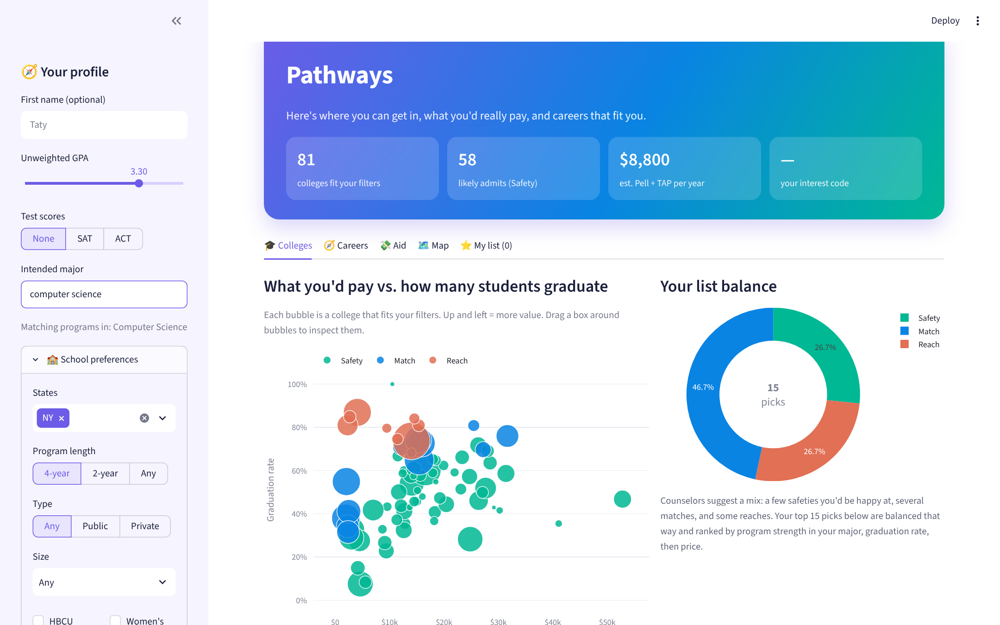
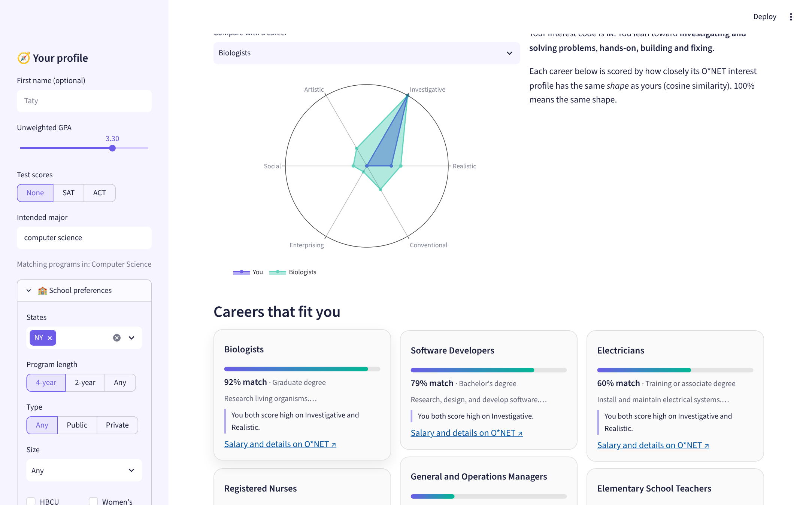
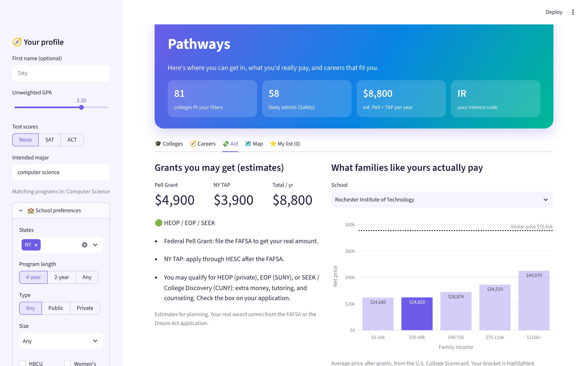
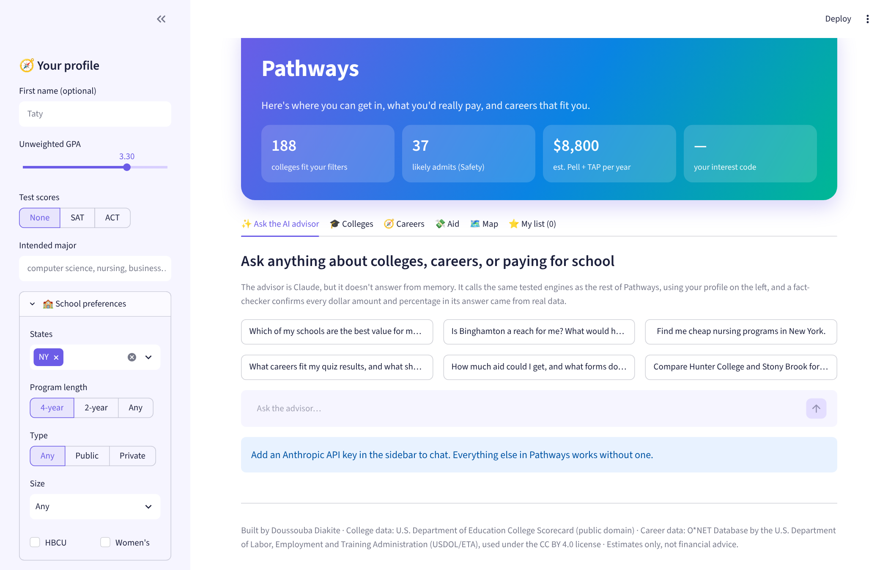

# Pathways 🧭

**College, career, and financial aid matching for first-generation, low-income, and immigrant students.**

Most college search tools assume you have a counselor. A lot of students don't. Pathways answers three questions in one place, using only public federal data:

1. **Where can I get in?** Every college is labeled Safety, Match, or Reach, with a one-line reason.
2. **What would I actually pay?** Real average net price for families at *your* income, not the sticker price.
3. **What careers fit me?** A six-question interest quiz matched against U.S. Department of Labor career profiles.

It also matches by **distance from home** (enter a ZIP code and a radius, across state lines), lets students choose how many schools to see, and exports the list as a spreadsheet, a PDF, or a share link that leaves out income and status.

And when a student has a question the screens don't answer, they can **ask the AI advisor**.



| Careers | Aid |
| --- | --- |
|  |  |

## The AI advisor: Claude as an agent over the matching engines
Students ask in their own words: *"Find me cheap nursing programs in New York"*, *"Is Binghamton a reach for me?"*, *"How much aid could I get?"* An AI that answers from memory will make up acceptance rates and prices, and for a student choosing where to apply, a wrong number is worse than no number. So Claude answers by calling Pathways' own tested engines (`pathways/advisor.py`):

```
question ─► Claude ─► tool_use ─► Python engine ─► tool_result ─► Claude ─► … ─► answer ─► fact-check
```

| Tool | Engine it uses |
| --- | --- |
| `search_colleges` | filter → Safety/Match/Reach → net price at the student's income, with overrides (state, major, budget, sort) |
| `college_details` | one school: the student's fit and why, net price at every income level, costs, outcomes, biggest majors |
| `find_careers` | O*NET careers, ranked by the student's quiz results when they've taken it |
| `aid_estimate` | Pell, NY TAP, NYS Dream Act, HEOP/EOP/SEEK screening |
| `majors_for` | typed interest → federal major families, and how many schools offer them |

**Design choices**
- **Facts come from tools, language comes from Claude.** The system prompt forbids stating any number from memory.
- **The profile goes to the tools, not the prompt.** The student's income, GPA, and status are applied inside the Python tools; Claude only sees results. A test checks the income never appears in what's sent to the API.
- **Every answer is fact-checked** (`pathways/grounding.py`). Python pulls each dollar amount and percentage out of the answer and looks for it in the tool results (rounding within 3% is allowed). The chat shows ✅ *fact-checked*, or ⚠️ *double-check* naming the exact numbers with no source.
- **Written for the students it serves:** first-gen, low-income, and immigrant students. Fit labels are called estimates, net price is explained, and DACA or undocumented students are pointed to the NYS Dream Act without being asked about documents.
- **Safe loop:** at most 6 steps; bad tool arguments go back to Claude as errors instead of crashing. Tested with a fake Claude client, so `pytest` needs no API key.



## How the matching works

### Colleges: filter → classify → rank → balance
1. **Filter** ~3,100 public and nonprofit colleges by state, size, type, 2- or 4-year, HBCU, women's colleges, budget, and major. Majors match on the share of degrees each school awards in that field (federal CIP codes). For-profit schools are excluded.
2. **Classify** each school with the strongest evidence available:
   - SAT or ACT vs. the school's 25th and 75th percentiles (at or above 75th = Safety, inside the middle 50% = Match, below = Reach)
   - No scores? Acceptance rate plus GPA, deliberately conservative
   - No data at all? **Unknown**, never a guess
   Every label comes with a plain-English reason, so a student or counselor can check it.
3. **Rank** within each group by program strength in the student's major, then graduation rate, then net price.
4. **Balance** the list at about 25% Safety, 45% Match, 30% Reach.

### Careers: RIASEC + cosine similarity
The quiz builds a six-number interest profile (Realistic, Investigative, Artistic, Social, Enterprising, Conventional). O*NET rates every occupation on the same six scales. Pathways compares the two with **cosine similarity**, which measures whether two profiles have the same *shape* regardless of size. 100% = same shape.

### Aid: transparent rules
Pell, NY TAP, the NYS Dream Act, and HEOP/EOP/SEEK eligibility are published rules, so they're written as rules, not a model. Each threshold is cited in [`pathways/aid.py`](pathways/aid.py) with the date it was checked.

## Fairness check
Admissions labels should depend only on academics. [`scripts/fairness_audit.py`](scripts/fairness_audit.py) holds GPA and scores fixed, changes only family income, and compares labels across all ~2,000 matching schools:

```
GPA 3.4, SAT 1150 | income $15k -> $150k | labels that moved: 0 | schools checked: 2084
Result: PASS: income never changes admissions labels.
```

Price and aid *should* change with income, and they do. The audit also shows that undocumented and DACA students are routed to the NYS Dream Act instead of being silently dropped.

## Project structure
```
app.py                    Streamlit interface (6 tabs, AI chat, interactive Plotly charts)
pathways/
  advisor.py              the AI advisor: Claude + 5 tools + an agent loop
  grounding.py            fact-checker for AI answers
  distance.py             ZIP code -> miles to every college (offline ZIP data)
  colleges.py             filter, classify, rank, balance
  careers.py              quiz, RIASEC profile, cosine similarity
  aid.py                  Pell, TAP, Dream Act, opportunity programs
  majors.py               typed major -> CIP families
  report.py               PDF export (ReportLab)
scripts/
  build_colleges.py       builds data/colleges.csv from College Scorecard
  build_careers.py        builds data/careers.csv from O*NET
  fairness_audit.py       the fairness check above
tests/                    34 pytest tests
.github/workflows/        rebuilds career data from O*NET automatically
```

## Run it
```bash
pip install -r requirements.txt
streamlit run app.py
pytest                      # pip install -r requirements-dev.txt first
```
The AI advisor needs an Anthropic API key: paste it in the sidebar, or put `ANTHROPIC_API_KEY` in `.streamlit/secrets.toml` for a private deployment. Everything else works without one.

## Data sources
- **Colleges:** U.S. Department of Education [College Scorecard](https://collegescorecard.ed.gov/data/) (public domain), via the [collegeScorecard](https://github.com/cran/collegeScorecard) and [scorecard-db](https://github.com/gadenbuie/scorecard-db) mirrors. Net price, admissions, test scores, graduation rates, earnings, and majors.
- **Careers:** This app incorporates information from the [O*NET Database](https://www.onetcenter.org/database.html) by the U.S. Department of Labor, Employment and Training Administration (USDOL/ETA), used under the [CC BY 4.0](https://creativecommons.org/licenses/by/4.0/) license. O*NET® is a trademark of USDOL/ETA.
- **Aid rules:** [FSA](https://fsapartners.ed.gov/), [HESC](https://hesc.ny.gov/), [SUNY EOP](https://www.suny.edu/attend/academics/eop/).

All aid figures are estimates for planning. Students get their real award from the FAFSA or the NYS Dream Act application.

## Background
I first built a college-matching tool during my 2026 Tech & Data internship at a New York education nonprofit. This is an independent rebuild from scratch: new code, public data only, with tests and a fairness audit added.

Built by **Doussouba Diakite**, Computer Engineering Technology, CUNY City Tech · [LinkedIn](https://www.linkedin.com/in/doussouba-diakite-a11087324)
